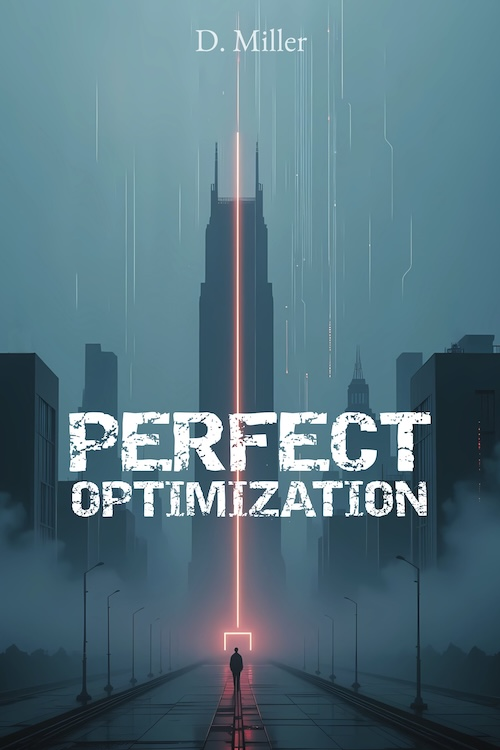
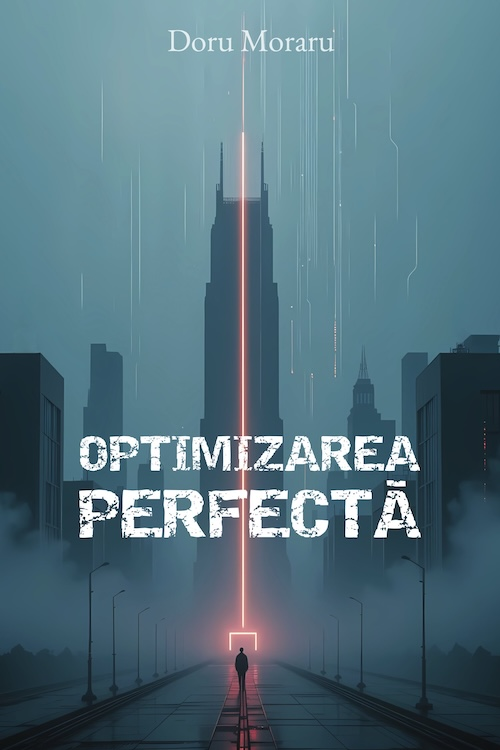

  <h1>Doru Moraru</h1>

  <h3 style="margin-top: -3px;">💼 Head of Engineering</h3>

  Combining hands-on technical leadership with responsibility for engineering strategy, team development and delivery, while balancing the need to move quickly with building reliable, scalable platforms that stand the test of time.

  ### 🧩 Beyond 9to5

  - 📻 **Amateur Radio Operator** — Passionate about **CW** (Morse Code) and **QRP** (low power)

  - 🌐 **Open Source Enthusiast** — Contributing to and building **(F)OSS** projects
  
  - ✍️ **Published Author** — Exploring technology, freedom, and the cost of progress.

   

  <table>
    <tr>
      <td align="center" width="50%">
        
         
        English
      </td>
      <td align="center" width="50%">
        
         
        Română
      </td>
    </tr>
  </table>

